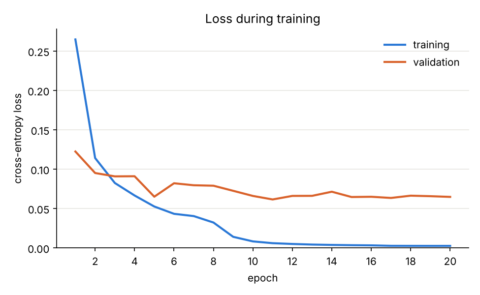
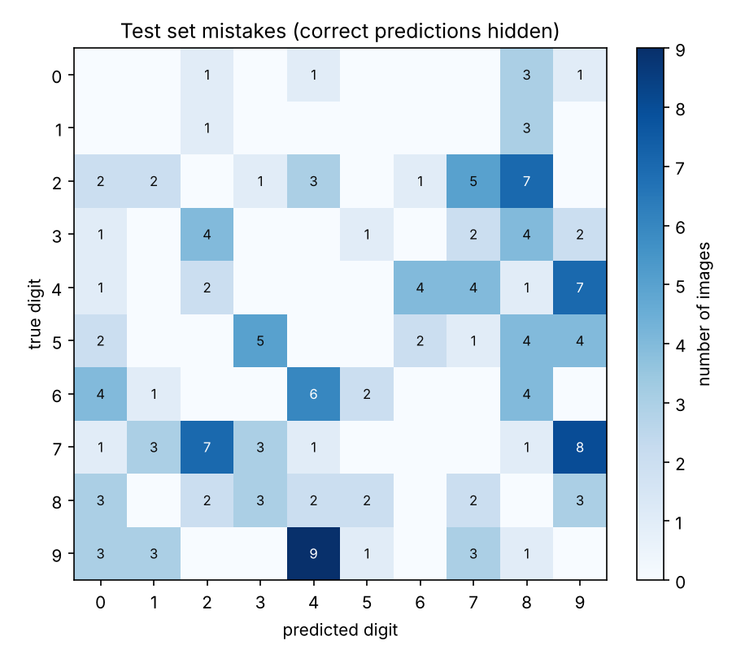
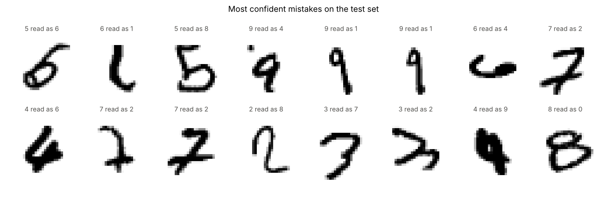

# MNIST from scratch

A neural network that reads handwritten digits, written with NumPy only. No PyTorch, TensorFlow or scikit-learn: the forward pass, backpropagation and the optimiser are all in [`network.py`](network.py), about 130 lines.

It reaches **98.40% accuracy** on the 10,000 MNIST test images after about 30 seconds of training on a 2-core CPU.

## Why

Calling `model.fit()` hides the part that is worth understanding. Writing the gradients by hand, and then checking them numerically, is the quickest way to find out whether you actually follow how a network learns.

## How it works

The network is a plain multilayer perceptron:

```
784 pixels -> Dense(128) -> ReLU -> Dense(64) -> ReLU -> Dense(10) -> softmax
```

- **Dense layer**: `out = x @ W + b`. On the way back it computes `dW = x.T @ grad`, `db = grad.sum(axis=0)` and passes `grad @ W.T` to the layer before it.
- **ReLU**: remembers which inputs were positive and lets the gradient through only there.
- **Loss**: softmax and cross-entropy are computed together, because the combined gradient simplifies to `(probabilities - one_hot) / batch_size`.
- **Initialisation**: He initialisation, so activations keep a sensible scale through the ReLU layers.
- **Optimiser**: mini-batch SGD with momentum 0.9, L2 weight decay of 1e-4, and a learning rate of 0.05 that halves every 8 epochs.

5,000 training images are held out for validation. The weights from the epoch with the best validation accuracy are kept, and the test set is only used once at the end.

## Checking the backward pass

Backprop bugs are easy to miss, because a network with a slightly wrong gradient often still learns, just worse. [`test_gradients.py`](test_gradients.py) nudges every parameter by a tiny amount, measures the change in the loss, and compares that with what `backward()` returned. The relative error has to be below 1e-6.

It also checks that softmax does not overflow on large logits and that the network can memorise a batch of 20 random points.

```
$ python test_gradients.py
backward pass matches numerical gradients
softmax is stable
network overfits a tiny batch
all checks passed
```

## Results

| Hidden layers | Change from default | Validation acc. | Test acc. | Train time |
|---|---|---|---|---|
| none | softmax regression only | 94.06% | 92.55% | 4 s |
| 64 | one hidden layer | 98.08% | 97.71% | 15 s |
| 128, 64 | no momentum | 98.12% | 97.65% | 25 s |
| 128, 64 | no weight decay | 98.26% | 98.21% | 23 s |
| **128, 64** | **default** | **98.64%** | **98.40%** | **26 s** |
| 256, 128 | wider | 98.68% | 98.42% | 46 s |

All runs use 20 epochs, batch size 64 and seed 0. Doubling the width costs almost twice the time for 0.02 points on the test set, so 128-64 is the default.



Training loss keeps falling while validation loss flattens after about epoch 10. The network is starting to memorise the training set at that point, which is why the best checkpoint is picked on validation accuracy and not the last epoch.



The 160 mistakes are not spread evenly. The most common are 9 read as 4 (9 times) and 7 read as 9 (8 times), pairs that look alike in handwriting.



Some of the most confident mistakes are hard for a person too.

## Run it

```
pip install -r requirements.txt
python test_gradients.py   # check the maths
python train.py            # downloads MNIST on first run, then trains
python evaluate.py         # per-digit accuracy and the figures above
```

Other settings:

```
python train.py --hidden 256 128 --epochs 30 --lr 0.05
```

## Files

| File | What it does |
|---|---|
| `network.py` | Dense, ReLU, softmax cross-entropy, the network and the SGD optimiser |
| `data.py` | Downloads MNIST, verifies checksums, parses the idx files |
| `train.py` | Training loop, validation, checkpointing |
| `evaluate.py` | Test accuracy, confusion matrix, figures |
| `test_gradients.py` | Numerical gradient check and sanity tests |

## Limitations and next steps

- A fully connected network ignores the fact that pixels next to each other are related. A convolutional layer would be the next thing to add and should push accuracy past 99%.
- No data augmentation. Small shifts and rotations would probably help with the slanted digits it gets wrong.
- Results are from a single seed, so differences of 0.1 points between rows are within run-to-run noise.
